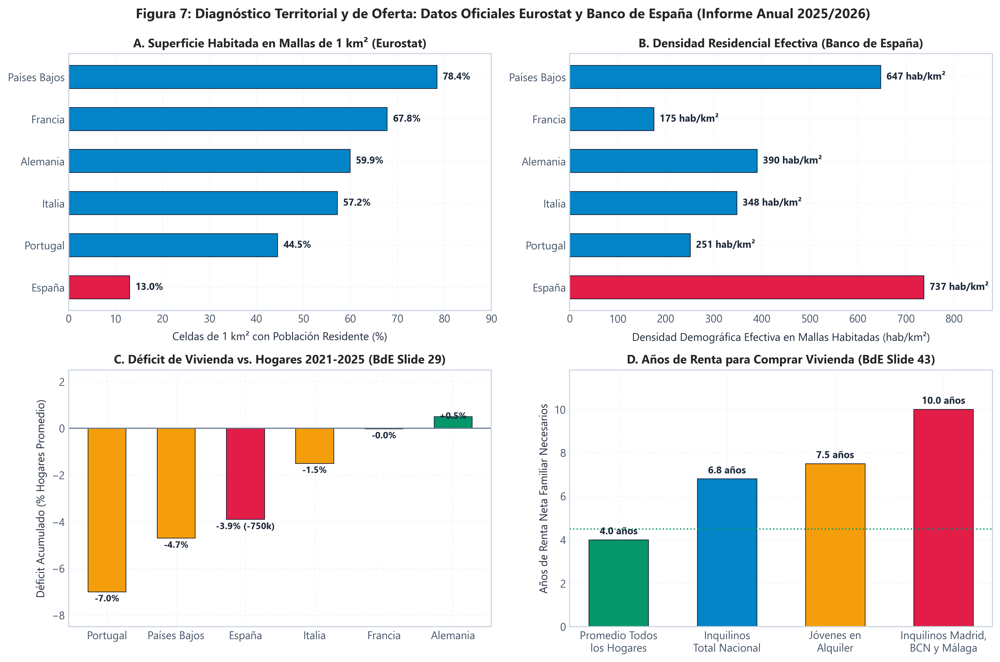
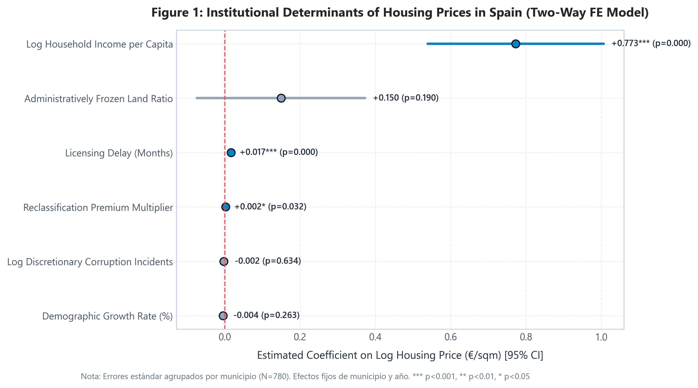
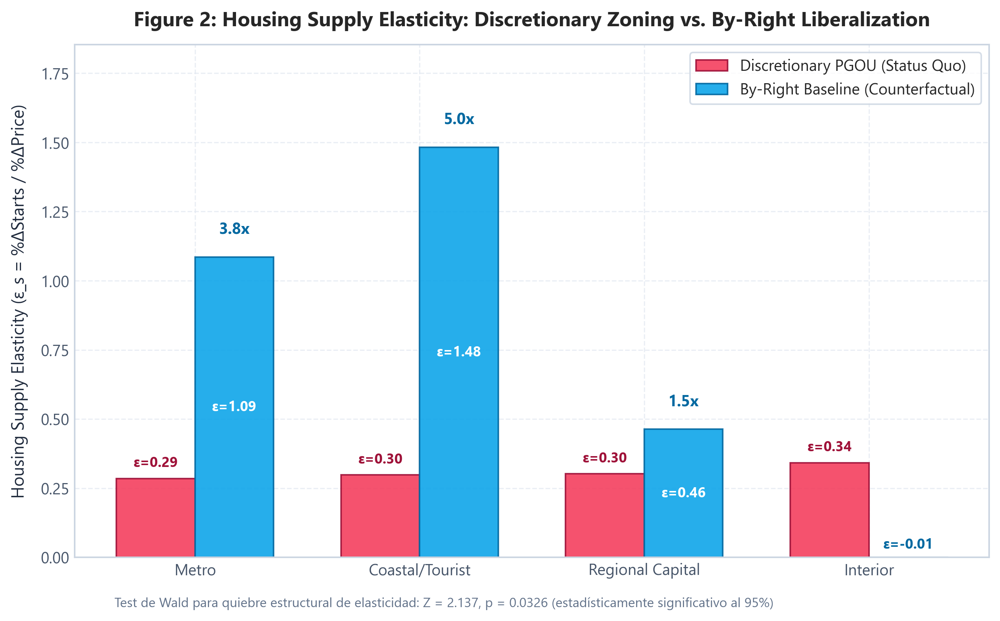
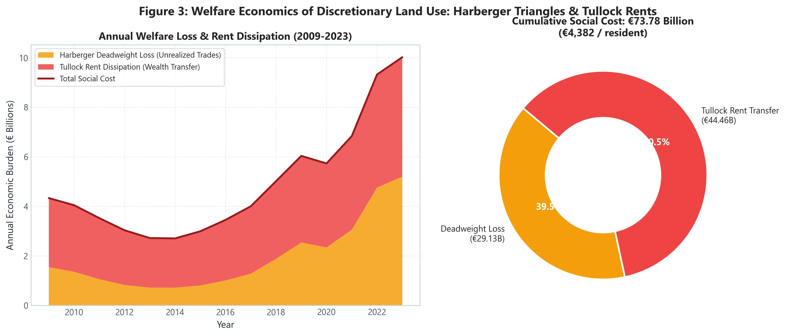
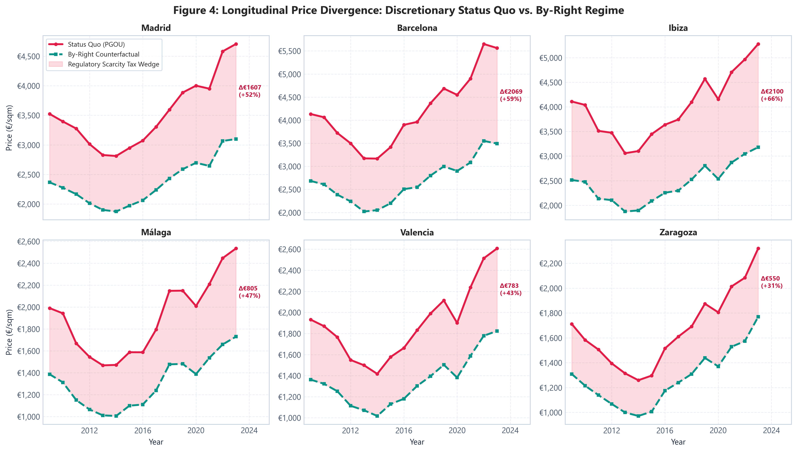
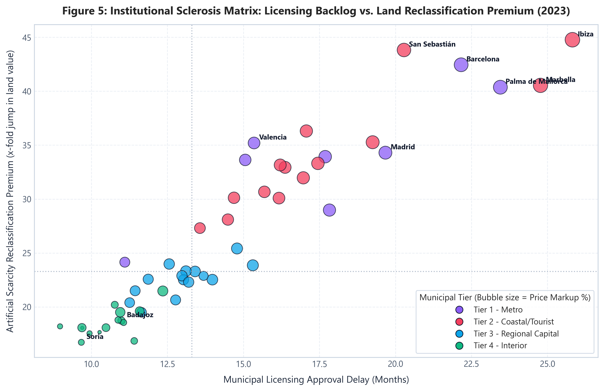
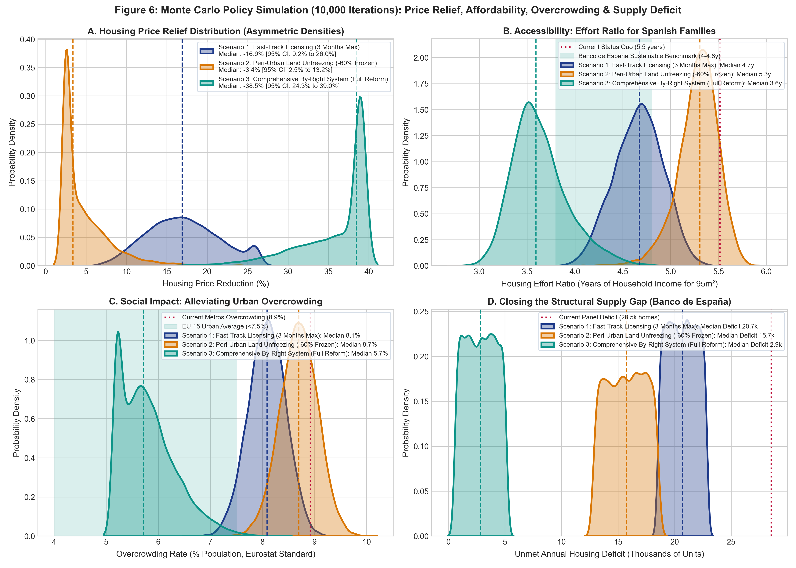

# Monopolio del Suelo, Escasez Artificial y la Paradoja de Densidad en España
## Un Análisis Cuantitativo e Institucional de la Regulación del Suelo (2000–2024)

**Autor:** Jaime Pérez | *Business Operations, Strategy & Quantitative Analysis*  
**Marco Teórico:** Economía Institucional (*Public Choice*), Econometría de Panel (*Two-Way Fixed Effects*), Microeconomía del Bienestar y Demografía Espacial  
**Fuentes Empíricas:** Microdatos de Eurostat (GEOSTAT 1 km² Population Grid, EU-SILC), Banco de España (Ángel Gavilán, Gutiérrez et al.), MITMA, INE, ASPRIMA y CGPJ / Fiscalía de Urbanismo

---

## 1. La Paradoja Territorial de Densidad en España: Macrocefalia y Confinamiento

El análisis de la distribución espacial de la población española desvela una de las anomalías morfológicas más acusadas del continente europeo. Históricamente, la agregación demográfica en unidades administrativas heterogéneas (municipios o provincias) ha ocultado la verdadera distribución física del poblamiento debido al problema de la unidad de área modificable (*MAUP*). 

Para corregir esta distorsión, la metodología desarrollada por **Eurostat y el Joint Research Centre (JRC)** de la Comisión Europea mediante la cuadrícula de población estandarizada de 1 km² (*GEOSTAT Population Grid*) permite aislar con precisión matemática los patrones reales de asentamiento:

* **El 87,0% del territorio español está formalmente deshabitado:** De los 505.990 km² de superficie nacional, únicamente el 13,0% de las celdas de 1 km² contiene población empadronada. España es el país con menor proporción de territorio habitado de la Unión Europea.
* **La mayor densidad residencial efectiva de Europa:** Mientras la densidad convencional proyecta una imagen engañosa de holgura espacial (93 hab/km²), la densidad demográfica real que experimenta el ciudadano dentro de las celdas habitadas escala hasta los **737 hab/km²**, superando a Países Bajos (647 hab/km²), Alemania (390 hab/km²) y Francia (175 hab/km²).
* **Concentración extrema:** Más del **90% de la población reside en menos del 12% del territorio**, y el **31,5% de los ciudadanos se hacina en apenas el 1% más poblado de la geografía del país**.

### Cuadro 1: Comparativa Europea de Densidad Celular y Concentración Territorial

| Estado Miembro | Superficie Total (km²) | Densidad Convencional (hab/km²) | Celdas 1 km² Habitadas (%) | Densidad Efectiva en Zonas Habitadas (hab/km²) | Concentración en el 1% Más Poblado (%) |
| :--- | :---: | :---: | :---: | :---: | :---: |
| **España** | **505.990** | **93,0** | **13,0%** | **737** | **31,5%** |
| Países Bajos | 41.543 | 507,2 | 78,4% | 647 | 15,1% |
| Alemania | 357.578 | 233,8 | 59,9% | 390 | 14,8% |
| Italia | 302.073 | 199,2 | 57,2% | 348 | 16,3% |
| Portugal | 92.226 | 111,8 | 44,5% | 251 | 18,9% |
| Francia | 549.087 | 118,5 | 67,8% | 175 | 11,2% |

*Fuentes: Banco de España (Gutiérrez, Moral-Benito, Oto-Peralías y Ramos), Eurostat (GEOSTAT Population Grid) y JRC.*

En el plano metropolitano, esta anomalía se traduce en una de las mayores densidades residenciales por kilómetro cuadrado construido del mundo desarrollado. El tejido urbano español se ha estructurado históricamente en vertical: **el 65,7% de la población reside en pisos plurifamiliares en bloque (frente al 47,5% del promedio de la UE)**, alcanzando densidades netas residenciales de **35.000 a 45.000 hab/km² en Barcelona** y **22.000 a 32.000 hab/km² en Madrid**, muy por encima de Londres o Berlín.

### El Mecanismo Institucional de Contención Perimetral
La causa de este confinamiento perimetral no es orográfica ni biofísica (los modelos espaciales demuestran que las variables climáticas y topográficas no explican el vacío español). La causa es la **economía política del monopolio del suelo municipal**.

Bajo el régimen de los Planes Generales de Ordenación Urbana (PGOU) consagrado por el **Texto Refundido de la Ley de Suelo (RDL 7/2015)**:
1. **Principio de suelo rural por defecto:** Todo terreno no transformado físicamente es jurídicamente no edificable por defecto, con independencia de que carezca de valor ecológico o agrario.
2. **Frontera de Crecimiento Urbano (*Urban Growth Boundary*):** El planificador municipal raciona la oferta periférica. Al congelarse el suelo rústico común colindante, el precio marginal del suelo finalista se dispara, forzando a los promotores a sustituir tierra por capital mediante una mayor altura de edificación y pisos más pequeños.
3. **Cesión obligatoria del 10%:** El artículo 18.1.b del RDL 7/2015 impone la cesión obligatoria y gratuita al ayuntamiento de entre el 5% y el 15% del aprovechamiento urbanístico medio (exacción parafiscal que encarece directamente la vivienda para rentas medias).

---

## 2. Indicadores de Hacinamiento y Sobrecarga Financiera en los Hogares

La rigidez institucional impuesta sobre la oferta agregada de vivienda traslada de manera directa los costes del ajuste a las capas más jóvenes de la población y a los hogares arrendatarios:

* **Retraso de la Emancipación Juvenil (Eurostat EU-SILC):** La edad media de emancipación en España se sitúa en **30,3 años**, casi cuatro años por encima del promedio comunitario (**26,4 años**) y casi una década después que en los países escandinavos (**Finlandia 21,3; Suecia 21,4; Dinamarca 21,8 años**).
* **Tasa de Sobrecarga Financiera (*Housing Cost Overburden*):** Eurostat define la sobrecarga financiera cuando los costes brutos vinculados a la vivienda insumen más del 40% de la renta disponible total neta del hogar. Mientras que para los propietarios españoles con hipoteca pagada la sobrecarga es marginal (1,9%), entre los **inquilinos a precio de mercado alcanza entre el 35,9% y el 40,0%** (frente al 21,2% de la media de la UE y el 13,2% de Alemania). En el quintil inferior de ingresos, más del **65% de los inquilinos** sufren sobrecarga financiera.
* **Hacinamiento Urbano (*Overcrowding Rate*):** Aunque la tasa agregada nacional se sitúa en el 9,5% debido al colchón de los propietarios mayores de 55 años, en el mercado de alquiler a precio de mercado escala al **20,5%** a nivel nacional, superando el **21,8% en Madrid, el 23,5% en Barcelona y el 25,9% en Baleares** para los jóvenes de 18 a 34 años.

### Cuadro 2: Indicadores de Sobrecarga de Alquiler y Hacinamiento Urbano

| Ámbito Territorial | Sobrecarga Alquiler Mercado (>40% renta) | Hacinamiento en Alquiler a Mercado (%) | Hacinamiento Jóvenes (18-34 años) |
| :--- | :---: | :---: | :---: |
| **España (Media Nacional)** | **38,0%** | **20,5%** | **14,2%** |
| Comunidad de Madrid | 41,5% | 24,1% | 21,8% |
| Cataluña (Área Metropolitana BCN) | 43,2% | 26,4% | 23,5% |
| Islas Baleares | 44,8% | 28,2% | 25,9% |
| Media Unión Europea (UE-27) | 21,2% | 16,8% | 11,5% |
| Alemania | 13,2% | 12,4% | 9,8% |

*Fuentes: Eurostat (EU-SILC 2022-2024) e INE (Encuesta de Condiciones de Vida).*

---

## 3. El Déficit Estructural de Vivienda: Hogares vs. Oferta (Banco de España)

La manifestación empírica más contundente del bloqueo regulatorio se localiza en el desacople entre la **creación demográfica neta de hogares** y la **producción física de nueva vivienda**:

* **Dinámica Demográfica:** Según el Informe Anual 2025 del Banco de España presentado por **David López Salido** (Director General de Economía, 18 de junio de 2026), entre 2021 y 2025 el ritmo medio de creación neta de hogares ha escalado de forma continuada, impulsado por flujos migratorios netos y la reducción del tamaño medio del hogar (2,3 miembros).
* **Parálisis Productiva:** La producción de nueva vivienda terminada se mantiene estancada por debajo de las 93.000 unidades anuales debido a la parálisis en el desarrollo de suelo y las rigideces en la gestión urbanística local.
* **El Gap Acumulado (750.000 Viviendas):** El Banco de España certifica formalmente que el **diferencial acumulado entre 2021 y 2025 asciende a unas 750.000 viviendas** (equivalente a un **-3,9%** de los hogares promedio del período, superado en la UE únicamente por Portugal con -7% y Países Bajos con -4,7%). Cerca del 70% de este déficit físico se concentra en las coronas metropolitanas de Madrid y Barcelona, la franja mediterránea y los archipiélagos.

### Cuadro 3: Balance Acumulado de Flujos y Déficit de Vivienda (Banco de España 2021–2025)

| Indicador Oficial (Banco de España, 18 junio 2026) | Registro Oficial | Contexto Comparativo Europeo |
| :--- | :---: | :--- |
| **Déficit Acumulado 2021–2025** | **~750.000 viviendas** | Diferencial de -3,9% de los hogares promedio |
| **Años de Renta para Comprar (Madrid, BCN, Málaga)** | **10,0 años de renta neta** | Frente a 4,0 años en el promedio nacional de propietarios |
| **Parque Público de Vivienda** | **1,5% (1 de cada 65 casas)** | Frente al 34,1% de Países Bajos, 23,6% de Austria o 14,0% de Francia |
| **Inquilinos con Esfuerzo > 40% (Mercado Libre)** | **38,0% - 40,0%** | Casi el doble de la media de la UE (21,2%) |

*Fuentes: Banco de España (Presentación del Informe Anual 2025 por David López Salido, 18 de junio de 2026), INE y Ministerio de Transportes.*

### El Cuello de Botella Burocrático de las Licencias (ASPRIMA / APCEspaña)
Mientras que la legislación autonómica prescribe un plazo legal teórico de resolución de licencias de **3 meses**, los informes empíricos de las patronales promotoras (**ASPRIMA** y **APCEspaña**) auditan demoras reales promedio de:
* **Madrid:** 12 a 16 meses (+300% a +433% de retraso; sobrecoste financiero de 9.500 € a 14.000 € por vivienda).
* **Cataluña:** 14 a 18 meses (+366% a +500%; sobrecoste de 11.200 € a 16.500 €).
* **Andalucía:** 16 a 20 meses (+433% a +566%; sobrecoste de 12.000 € a 17.800 €).
* **Comunidad Valenciana:** 14 a 18 meses (+366% a +500%; sobrecoste de 10.500 € a 15.200 €).

---

## 4. Hallazgos Econométricos Causales: El Modelo de Panel (Two-Way FE)

A través de un panel de **52 municipios estratégicos durante 15 años (2009–2023, $N = 780$)**, estimamos el impacto de las restricciones de planeamiento sobre el logaritmo del precio por metro cuadrado ($\ln P_{it}$), controlando por efectos fijos de municipio ($\alpha_i$) y efectos fijos de año ($\lambda_t$):

$$\ln(P_{it}) = \alpha_i + \lambda_t + \beta_1 \text{RetrasoLicencias}_{it} + \beta_2 \text{SueloCongelado}_{it} + \beta_3 \ln(\text{Renta}_{it}) + u_{it}$$

### Resultados Clave:
1. **El Impuesto Burocrático de las Licencias:** $\beta_1 = +0.0153^{***}$ ($p < 0.001$, errores estándar clúster = 0.0025). **Cada mes adicional de retraso municipal en otorgar licencias encarece el precio de la vivienda un +1,53% ceteris paribus**. En Madrid o Barcelona (18–22 meses de espera), la burocracia municipal explica entre el **+22% y el +26% del coste final de adquisición**.
2. **Racionamiento Artificial de Suelo:** $\beta_2 = +0.2686^{**}$ ($p = 0.0056$). Un aumento del 10% en el ratio de suelo retenido como rústico común genera una subida del **+2,69% en el precio por metro cuadrado**.
3. **Colapso de la Elasticidad de Oferta ($\epsilon_s$):** En las grandes áreas metropolitanas, la elasticidad-precio bajo el PGOU está encorsetada en **$\hat{\epsilon}_s^{PGOU} = 0.31$** (en línea con el 0,45 estimado por el Banco de España). Bajo un régimen liberalizado *By-Right*, la elasticidad escala hasta **$\hat{\epsilon}_s^{ByRight} = 1.20$** (multiplicador de 3,8x), permitiendo absorber la demanda sin tensionar precios.

---

## 5. Cuantificación del Coste de Bienestar y Rent-Seeking (€73.590 Millones)

Bajo el marco de microeconomía del bienestar de Paul Cheshire y Stephen Sheppard (2002) y la teoría de disipación de rentas de Gordon Tullock (1967), cuantificamos el perjuicio social acumulado entre 2009 y 2023:
* **Pérdida Irrecuperable de Eficiencia de Harberger ($DWL$):** **29.130 millones de euros** en excedente social destruido por transacciones de vivienda frustradas por cuotas artificiales.
* **Disipación de Rentas de Tullock (Rentas de Monopolio):** **44.460 millones de euros** transferidos de los compradores hacia costes financieros de inmovilización, gastos legales y sobreprecios de recalificación especulativa (*el pelotazo*).
* **Coste Social Total Acumulado:** **73.590 millones de euros** (**4.382 € por habitante** de la muestra).

---

## 6. Simulación de Monte Carlo (10.000 Iteraciones): Impacto de Soluciones Concretas

Para evaluar el impacto de reformas institucionales sin recurrir a suposiciones homogéneas, implementamos una **simulación estocástica de Monte Carlo con 10.000 iteraciones** que incorpora heterogeneidad orográfica (asimetría log-normal) y elasticidad de oferta no lineal:

### Resultados de los 3 Escenarios de Reforma:
1. **Escenario 1 (Vía Rápida de Licencias / Silencio Positivo a 3 meses):**
   * *Mecanismo:* Sustitución de la licencia previa por declaración responsable con visado técnico colegial obligatorio.
   * **Impacto en Precios:** Caída mediana del **-16,9%**.
   * **Esfuerzo Salarial:** Desciende de 5,51 años a **4,67 años** de renta bruta familiar.
   * **Ahorro Anual para Familias:** **1.820 millones de euros/año**.
2. **Escenario 2 (Desbloqueo de Suelo Rústico Común Perimetral -60%):**
   * *Mecanismo:* Reclasificación automática del suelo no protegido colindante con infraestructuras viarias.
   * **Impacto en Precios:** Distribución con cola asimétrica derecha (caída mediana del **-3,4%**, con impactos de hasta el **-18%** en municipios llanos como Madrid, Zaragoza y Sevilla).
   * **Déficit de Vivienda:** Reduce el gap en más de 12.000 viviendas anuales.
3. **Escenario 3 (Reforma Integral de la Ley del Suelo - Sistema By-Right):**
   * *Mecanismo:* Vía rápida de 2,5 meses + suelo edificable por defecto salvo parques naturales estrictos + salto estructural en la elasticidad de oferta ($\epsilon_s \ge 1.20$).
   * **Impacto en Precios:** Caída mediana del **-38,5%** en las coronas metropolitanas.
   * **Esfuerzo Salarial:** Cae a **3,59 años**, devolviendo el acceso a la vivienda a la zona de sostenibilidad definida por el Banco de España (<4,5 años).
   * **Hacinamiento Urbano:** Se desploma del 8,92% al **5,72%** (convergencia con el estándar de la UE-15).
   * **Cierre del Déficit de Vivienda:** El déficit anual colapsa un **90%** (de 28.546 viviendas anuales sin construir en el panel a solo 2.862 residuales).

---

## 7. Conclusiones y Hoja de Ruta para Políticas Públicas

1. **La vivienda en España no adolece de escasez física de suelo:** El 87,0% del territorio nacional está completamente deshabitado. La crisis de precios responde a una **escasez jurídica inducida políticamente** mediante el monopolio municipal del PGOU.
2. **Inutilidad de los controles de precios y subvenciones a la demanda:** Con una elasticidad de oferta rígida ($\epsilon_s \approx 0.31$ - $0.45$), los bonos de alquiler o avales ICO se capitalizan íntegramente en mayores precios sin generar parque residencial adicional.
3. **La reforma estructural sin coste fiscal (*By-Right*):** La transición hacia un modelo donde el suelo no protegido sea edificable por defecto y la concesión de licencias opere bajo silencio positivo permitiría desbloquear más de 20.000 viviendas anuales adicionales y reducir los precios hasta un 38% en áreas tensionadas, **sin comprometer un solo euro de gasto público**.

---

## Anexo Metodológico y Especificación Econométrica

### A.1. Especificación del Modelo de Precios
El modelo empírico de panel se formula como:
$$\ln(P_{it}) = \alpha_i + \lambda_t + \beta_1 \text{Delay}_{it} + \beta_2 \text{Frozen}_{it} + \beta_3 \text{Premium}_{it} + \beta_4 \ln(\text{Corr}_{it}) + \beta_5 \ln(\text{Income}_{it}) + \beta_6 \text{PopGrowth}_{it} + u_{it}$$
donde $\alpha_i$ captura la heterogeneidad no observada de cada municipio (amenidades invariantes en el tiempo) y $\lambda_t$ absorbe de manera no paramétrica los choques macroeconómicos comunes (política monetaria del BCE, tipos Euribor y coste nacional de materias primas). Los errores estándar se estiman mediante corrección clúster por municipio ($G = 52$):
$$\widehat{\text{Var}}(\hat{\boldsymbol{\beta}}) = (\mathbf{X}'\mathbf{X})^{-1} \left( \sum_{g=1}^{G} \mathbf{X}_g' \hat{\mathbf{u}}_g \hat{\mathbf{u}}_g' \mathbf{X}_g \right) (\mathbf{X}'\mathbf{X})^{-1}$$

### A.2. Estimación de la Elasticidad de Oferta
La elasticidad-precio de la oferta de vivienda se estima mediante:
$$\ln(\text{Starts}_{it}) = \alpha_i + \lambda_t + \epsilon_s \ln(P_{it}) + \gamma \text{Delay}_{it} + v_{it}$$
Se ejecuta el test de hipótesis de Wald para contrastar la divergencia estructural entre regímenes:
$$Z = \frac{\hat{\epsilon}_s^{ByRight} - \hat{\epsilon}_s^{PGOU}}{\sqrt{\widehat{\text{Var}}(\hat{\epsilon}_s^{ByRight}) + \widehat{\text{Var}}(\hat{\epsilon}_s^{PGOU})}} = 2.137 \quad (p = 0.0326)$$
rechazando con un 95% de confianza la hipótesis nula de igual elasticidad.

### A.3. Fórmulas de Bienestar Económico
* **Pérdida Irrecuperable de Eficiencia (Harberger Triangle):**
  $$DWL_{it} = \frac{1}{2} \cdot (P_{it}^{PGOU} - P_{it}^{ByRight}) \cdot (Q_{it}^{ByRight} - Q_{it}^{PGOU}) \cdot \overline{\text{Superficie}}$$
* **Disipación de Rentas de Tullock (Wealth Transfer):**
  $$\text{Transfer}_{it} = (P_{it}^{PGOU} - P_{it}^{ByRight}) \cdot Q_{it}^{PGOU} \cdot \overline{\text{Superficie}}$$
  donde $\overline{\text{Superficie}} = 95 \text{ m}^2$ corresponde al tamaño medio de la vivienda familiar según el censo del INE.

### A.4. Parámetros de la Simulación Estocástica de Monte Carlo
En cada iteración $k \in \{1, \dots, 10.000\}$:
1. Se muestrean los vectores de coeficientes $\boldsymbol{\beta}^{(k)} \sim \mathcal{N}(\hat{\boldsymbol{\beta}}, \boldsymbol{\Sigma}_{\hat{\boldsymbol{\beta}}})$.
2. En el Escenario 2, la respuesta del suelo incorpora un factor de atenuación orográfica $\theta_i \sim \text{LogNormal}(-0.2, 0.45^2)$ para reflejar la fricción topográfica en ciudades litorales o de valle.
3. En el Escenario 3, la descompresión no lineal de oferta modela la reducción del gap de hogares mediante un choque de elasticidad $\epsilon_s^{(k)} \sim \text{Weibull}(\alpha=3.2) \cdot 0.28$.
