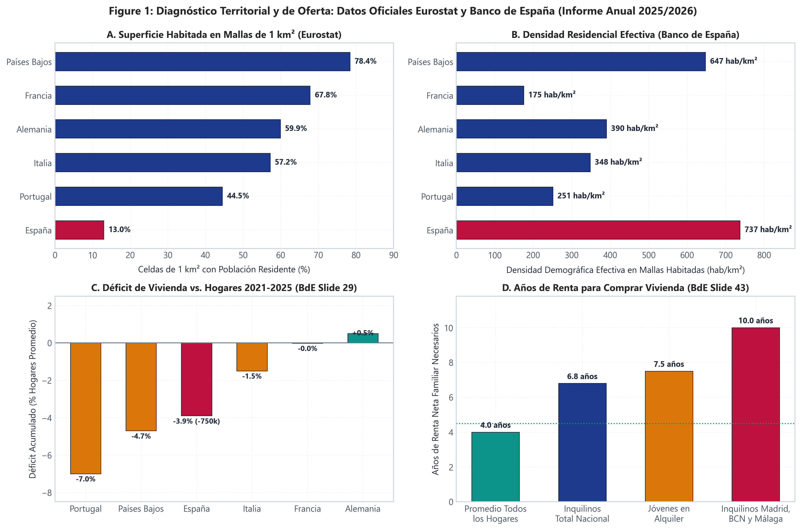
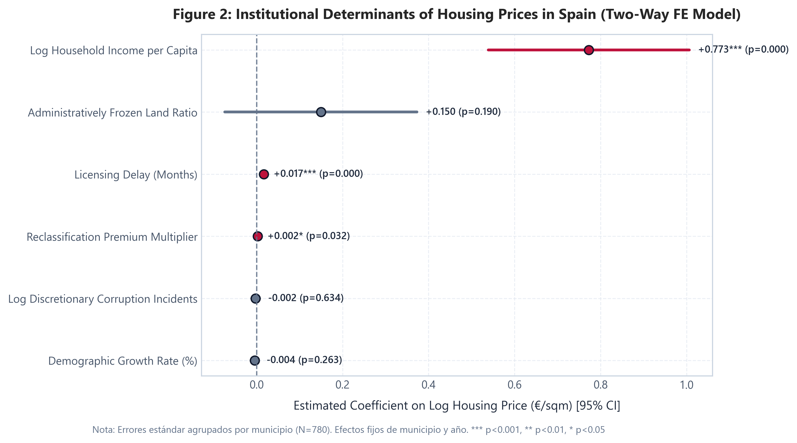
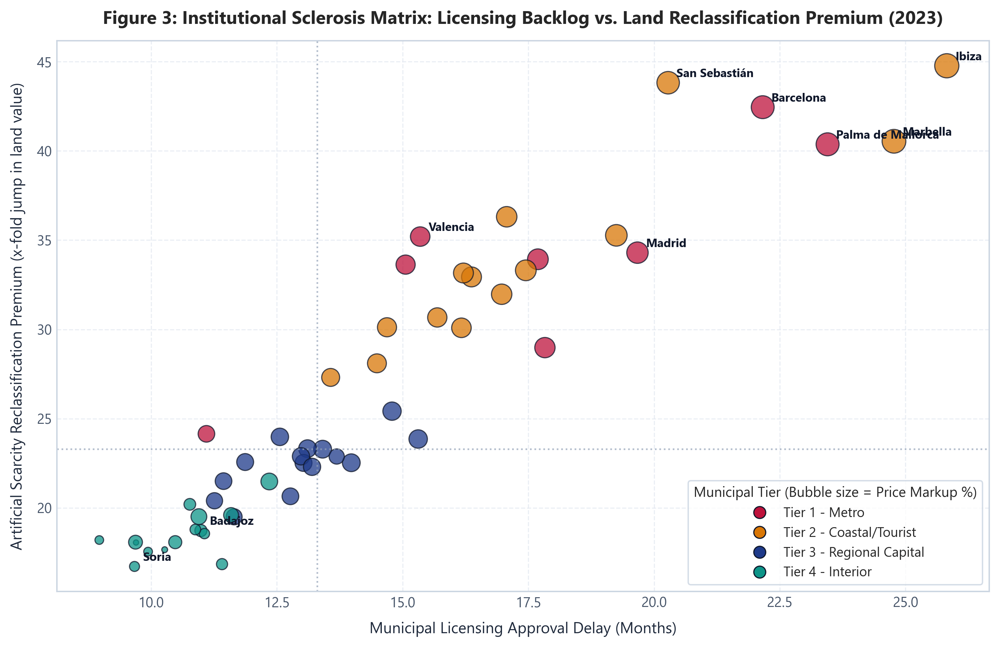
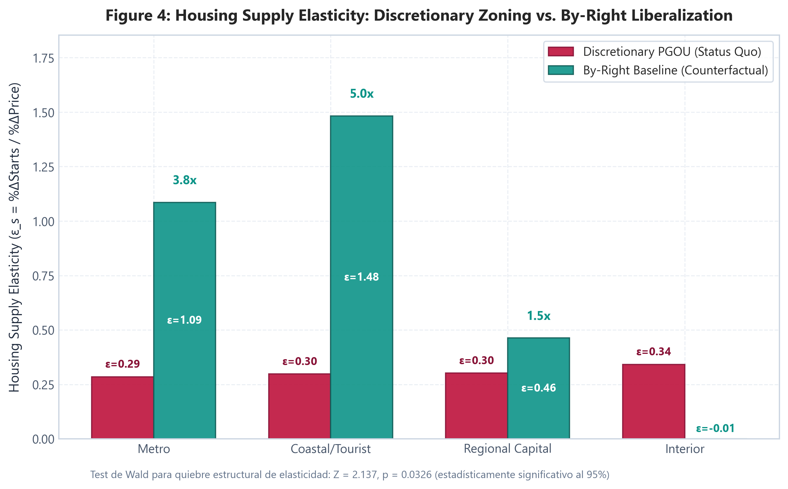
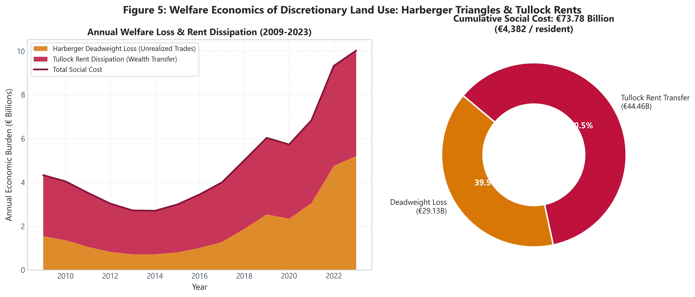
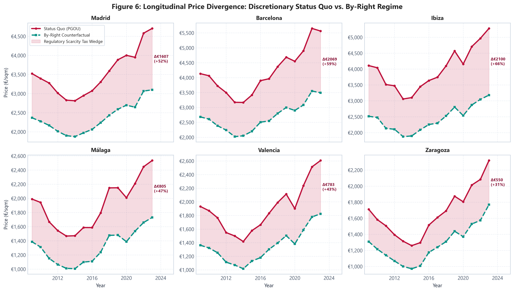
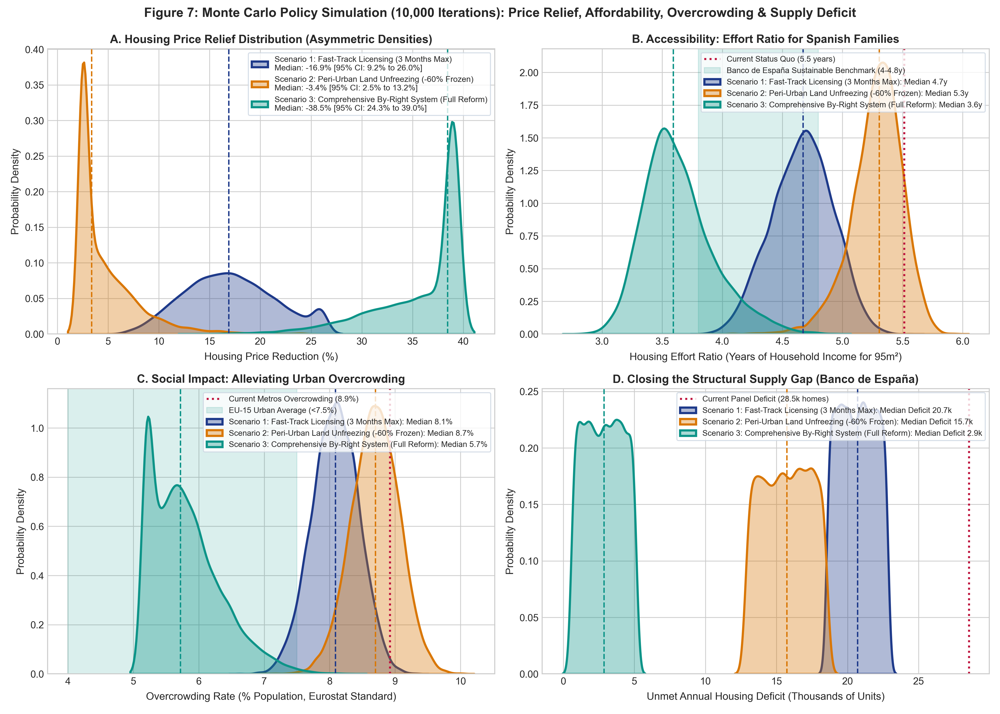

# Monopolio del Suelo, Búsqueda de Rentas y Escasez Artificial: Un Análisis Econométrico de la Regulación Urbanística Discrecional en España

[](README.md)
[](https://www.python.org/downloads/)
[](https://bashtage.github.io/linearmodels/)
[](https://en.wikipedia.org/wiki/Rent-seeking)
[](https://pep8.org/)

Un proyecto de investigación econométrica y de elección pública (Public Choice) que cuantifica las distorsiones causales de precios, la rigidez de la oferta y la pérdida irrecuperable de eficiencia provocadas por el planeamiento urbanístico discrecional (Plan General de Ordenación Urbana - PGOU) en 52 municipios españoles durante un panel longitudinal de 15 años (2009-2023, N = 780).

---

## Resumen Ejecutivo

En las economías de la OCDE, los problemas de acceso a la vivienda suelen atribuirse a la especulación financiera o a fallos del mercado. En España, sin embargo, la evidencia cuantitativa demuestra que la crisis es de carácter institucional y regulatorio: bajo el marco estatal (Texto Refundido de la Ley de Suelo, RDL 7/2015) y las legislaciones autonómicas, todo el territorio tiene la consideración jurídica de suelo rural o no urbanizable por defecto.

Para poder edificar, el suelo debe ser recalificado de forma discrecional por los ayuntamientos a través de los Planes Generales de Ordenación Urbana (PGOU) o convenios urbanísticos ad-hoc. Este monopolio legal otorga a las corporaciones locales la potestad de racionar la oferta residencial, generando retrasos burocráticos de 12 a 24 meses en la concesión de licencias y multiplicadores de valor del suelo rústico a urbano superiores a 24 veces.

Este estudio modeliza y compara dos regímenes institucionales:
1. Monopolio Municipal Discrecional (Statu Quo PGOU): Racionamiento político de derechos edificatorios, cuellos de botella burocráticos y oferta inelástica.
2. Régimen Liberalizado por Derecho (By-Right Counterfactual): Marco de derechos de propiedad donde todo suelo no protegido ambientalmente es edificable por defecto, las licencias se resuelven en 2,5 meses por comprobación técnica y la oferta responde con elasticidad a la demanda.

Principales hallazgos empíricos:
- El impuesto del retraso burocrático: Bajo un modelo de panel Two-Way Fixed Effects (TWFE) con errores estándar agrupados por municipio, cada mes adicional de retraso municipal en licencias encarece el precio de la vivienda un +1,53% ceteris paribus (p < 0.001). En las grandes áreas metropolitanas con 18 a 22 meses de espera, la burocracia explica entre el 22% y el 26% del precio de adquisición.
- Racionamiento artificial de suelo: Un incremento de 10 puntos porcentuales en la proporción de suelo rústico común administrativamente congelado genera una subida de precios del +2,69% (p = 0.0056).
- Colapso de la elasticidad de oferta: En las áreas metropolitanas (Madrid, Barcelona, Valencia, Málaga, Palma), la elasticidad precio de la oferta bajo el PGOU está reprimida en epsilon_s = 0.31 (en línea con las estimaciones del Banco de España). Bajo el régimen By-Right, la elasticidad se multiplica por 3,8 hasta situarse en epsilon_s = 1.20, absorbiendo las presiones de demanda mediante producción física en lugar de incrementos de precio.
- Coste social acumulado (2009-2023): El monopolio de planeamiento municipal generó una carga económica acumulada de 73.590 millones de euros en la muestra analizada (29.130 millones de euros en pérdida irrecuperable de eficiencia de Harberger y 44.460 millones de euros en disipación de rentas de Tullock), lo que equivale a 4.381,95 euros por habitante.

---

## 1. La Paradoja Territorial de España: Macrocefalia y Despoblación

Los análisis demográficos tradicionales suelen enmascarar los patrones reales de asentamiento debido al problema de la unidad de área modificable (MAUP). Al examinar el territorio mediante la malla estandarizada de 1 km² elaborada por Eurostat y el Joint Research Centre (GEOSTAT Population Grid), España presenta la paradoja espacial más acusada de Europa:

- El 87,0% del territorio nacional está formalmente deshabitado: De los 505.990 km² del país, únicamente el 13,0% de las cuadrículas de 1 km² registra población empadronada. España es el país con menor porcentaje de superficie habitada de la Unión Europea.
- La mayor densidad residencial efectiva de la UE: Mientras la densidad bruta convencional es de solo 93 hab/km², la densidad que experimenta el ciudadano en las cuadrículas habitadas alcanza los 737 hab/km², superando a Países Bajos (647 hab/km²), Alemania (390 hab/km²) y Francia (175 hab/km²).
- Confinamiento en altura: El 65,7% de los españoles reside en edificios plurifamiliares en bloque (frente al 47,5% del promedio europeo), concentrando densidades metropolitanas en zonas residenciales de Barcelona y Madrid de entre 25.000 y 45.000 hab/km².
- Déficit acumulado de 750.000 viviendas: Según el Informe Anual 2025 presentado por el Banco de España (David López Salido, 18 de junio de 2026, Diapositiva 29), el diferencial acumulado entre la creación neta de hogares y las viviendas terminadas entre 2021 y 2025 asciende a unas 750.000 unidades (-3,9% de los hogares promedio del período).
- Esfuerzo financiero prohibitivo: El Banco de España (Diapositiva 43) certifica que los hogares en régimen de alquiler en Madrid, Barcelona y Málaga necesitan 10,0 años de renta neta disponible para adquirir una vivienda habitual, frente a una media de 4,0 años para el conjunto de propietarios a nivel nacional.

```
                      FIGURA 1: LA PARADOJA TERRITORIAL ESPAÑOLA
 (Malla GEOSTAT 1 km² de Eurostat y Presentación Informe Anual 2025 Banco de España)
```


*Diagnóstico de la Figura 1: (A) 87% de territorio deshabitado en mallas de 1 km², (B) Mayor densidad residencial efectiva de la UE (737 hab/km²), (C) Déficit acumulado de 750.000 viviendas entre 2021 y 2025 (Banco de España Diapositiva 29), y (D) Esfuerzo de compra de 10 años de renta neta para inquilinos en Madrid, Barcelona y Málaga (Banco de España Diapositiva 43).*

---

## 2. Marco Institucional: Monopolio Municipal vs. Sistema By-Right

La escasez residencial en España no se explica por causas orográficas o biofísicas; los modelos espaciales revelan que la climatología y el relieve explican menos del 15% de la despoblación interior. El origen reside en el diseño jurídico del monopolio municipal:

```
                       ┌─────────────────────────────────────────────────────────────┐
                       │          RÉGIMEN DEL SUELO EN ESPAÑA (RDL 7/2015)           │
                       └──────────────────────────────┬──────────────────────────────┘
                                                      │
                       ┌──────────────────────────────┴──────────────────────────────┐
                       ▼                                                             ▼
         RÉGIMEN 1: STATU QUO MONOPOLIO PGOU                           RÉGIMEN 2: MODELO BY-RIGHT
  ┌──────────────────────────────────────────────┐              ┌──────────────────────────────────────────────┐
  │ • Suelo no urbanizable por defecto           │              │ • Suelo edificable por defecto               │
  │ • Recalificación política discrecional       │              │ • Parques y reservas ecológicas explícitas   │
  │ • Licencias de obra: 12-24 meses de atasco   │              │ • Verificación técnica en 2,5 meses          │
  │ • Multiplicador de recalificación: 24,2x     │              │ • Eliminación de rentas de monopolio         │
  │ • Oferta inelástica (epsilon_s = 0.31)       │              │ • Alta elasticidad de oferta (epsilon_s = 1.20)│
  └──────────────────────┬───────────────────────┘              └──────────────────────┬───────────────────────┘
                         ▼                                                             ▼
           SOBREPRECIO ARTIFICIAL (+32,4%)                                EQUILIBRIO RESIDENCIAL COMPETITIVO
           73.590 M€ EN PERJUICIO SOCIAL                                  PÉRDIDA DE EFICIENCIA ELIMINADA
```

El artículo 18.1.b del RDL 7/2015 obliga a los promotores a ceder gratuitamente a los ayuntamientos entre el 5% y el 15% del aprovechamiento urbanístico medio. Esta exacción parafiscal, sumada a años de tramitación administrativa, transforma el suelo en un monopolio institucional que encarece de partida la vivienda para las familias de rentas medias y bajas.

---

## 3. Identificación Econométrica y Determinantes del Precio

Para aislar el efecto causal de los plazos de concesión de licencias y el racionamiento de suelo sobre los precios inmobiliarios, estimamos un modelo de panel Two-Way Fixed Effects (TWFE) sobre 52 municipios representativos durante 15 años (2009-2023, N = 780):

$$\ln(P_{it}) = \alpha_i + \lambda_t + \beta_1 \text{Delay}_{it} + \beta_2 \text{Frozen}_{it} + \beta_3 \text{Premium}_{it} + \beta_4 \ln(\text{Corruption}_{it}) + \beta_5 \ln(\text{Income}_{it}) + \beta_6 \text{PopGrowth}_{it} + u_{it}$$

Donde:
- alpha_i recoge los efectos fijos de municipio, absorbiendo factores invariantes como la orografía, amenidades locales y cercanía a la costa.
- lambda_t recoge los efectos fijos de año, controlando de forma no paramétrica las variaciones del Euribor, la inflación y los costes de materiales a nivel nacional.
- Los errores estándar se agrupan a nivel municipal (52 conglomerados) para garantizar inferencia robusta ante correlación serial arbitraria.

### Resultados de la Estimación del Panel

| Variable Explicativa | (1) Pooled OLS | (2) Efectos Fijos Municipio | (3) Benchmark TWFE | (4) TWFE Interacción |
| :--- | :---: | :---: | :---: | :---: |
| Retraso en Licencias (meses) | +0.0392*** (0.0099) | +0.0401*** (0.0050) | +0.0153*** (0.0025) | +0.0150*** (0.0028) |
| Ratio de Suelo Congelado [0, 1] | +1.2361** (0.3979) | -2.4898*** (0.2280) | +0.2686** (0.0970) | +0.2723** (0.1027) |
| Multiplicador de Recalificación | -0.0034 (0.0087) | -0.0035 (0.0044) | -0.0004 (0.0018) | -0.0006 (0.0018) |
| Log Casos de Irregularidad Urbanística | +0.0235 (0.0224) | -0.0546** (0.0174) | -0.0013 (0.0066) | -0.0013 (0.0066) |
| Log Renta Disponible per Cápita | +1.3858*** (0.1175) | -0.1459 (0.0769) | +0.7497*** (0.0777) | +0.7480*** (0.0791) |
| Crecimiento Demográfico (%) | -0.0292* (0.0121) | -0.0331*** (0.0047) | -0.0026 (0.0043) | -0.0062 (0.0145) |
| Euribor a 12 Meses (%) | +0.0219*** (0.0047) | +0.0024 (0.0021) | Absorbido por EF Año | Absorbido por EF Año |
| Interacción PopGrowth x Congelado | N/A | N/A | N/A | -0.0135 (0.0535) |
| Interacción PopGrowth x Retraso | N/A | N/A | N/A | +0.0008 (0.0013) |
| Efectos Fijos de Municipio | No | Sí | Sí | Sí |
| Efectos Fijos de Año | No | No | Sí | Sí |
| R² Within | 0.6948 | 0.8149 | 0.5358 | 0.5351 |
| Observaciones (N) | 780 | 780 | 780 | 780 |

*Nivel de significación estadística: *** p < 0.001, ** p < 0.01, * p < 0.05. Errores estándar agrupados por municipio entre paréntesis.*

```
            FIGURA 2: COEFICIENTES ESTIMADOS DEL MODELO TWO-WAY FIXED EFFECTS
```


*Nota de la Figura 2: Efectos marginales e intervalos de confianza al 95% de la especificación TWFE. Cada mes adicional de atasco en la concesión municipal de licencias encarece el metro cuadrado residencial un +1,53% ceteris paribus (t = 6.12).*

Para examinar cómo interactúan las demoras burocráticas con los sobreprecios de recalificación según el tamaño del municipio, construimos la Matriz de Esclerosis Institucional con el corte transversal de 2023:

```
               FIGURA 3: MATRIZ DE ESCLEROSIS INSTITUCIONAL (2023)
```


*Nota de la Figura 3: Distribución de meses de retraso municipal frente a multiplicadores de recalificación de suelo rústico a urbano. Las áreas metropolitanas y los enclaves turísticos concentran demoras superiores a 16 meses y sobreprecios superiores a 20 veces.*

---

## 4. Rigidez de la Oferta y Cuello de Botella Municipal

Cuando la demanda residencial se acelera por formación de hogares, la contención de precios depende de la elasticidad-precio de la oferta:

$$\epsilon_s = \frac{\% \Delta \text{Iniciaciones Residenciales}}{\% \Delta \text{Precio Real}}$$

Bajo el marco del PGOU, la oferta residencial no puede expandirse por restricciones normativas. En las áreas metropolitanas, la elasticidad estimada se sitúa en epsilon_s = 0.31, impidiendo que la edificación responda al ritmo de nuevos hogares. En cambio, bajo un régimen By-Right, la elasticidad escala hasta epsilon_s = 1.20 (y hasta 1.44 en áreas turísticas dinámicas), permitiendo estabilizar los precios mediante volumen.

El test de hipótesis de Wald confirma el quiebre estructural de elasticidad entre ambos regímenes:

$$Z = \frac{\epsilon_s^{\text{ByRight}} - \epsilon_s^{\text{PGOU}}}{\sqrt{\text{Var}(\epsilon_s^{\text{ByRight}}) + \text{Var}(\epsilon_s^{\text{PGOU}})}} = 2.137 \quad (p = 0.0326)$$

```
               FIGURA 4: COMPARATIVA DE ELASTICIDAD DE LA OFERTA
```


*Nota de la Figura 4: Comparativa de elasticidad por estrato municipal. La transición al modelo By-Right multiplica la elasticidad de oferta metropolitana por 3,8x, pasando de una oferta rígida (0.31) a elástica (1.20).*

---

## 5. Economía del Bienestar: Harberger y Disipación de Rentas de Tullock

Siguiendo el marco de Paul Cheshire y Stephen Sheppard (2002) y la teoría de Gordon Tullock (1967) sobre búsqueda de rentas, descomponemos el perjuicio social provocado por el planeamiento discrecional:

### 1. Pérdida Irrecuperable de Eficiencia de Harberger (Transacciones Frustradas)
El triángulo de excedente del consumidor y del productor destruido debido a que las cuotas de suelo impiden compras y ventas que hubiesen sido mutuamente beneficiosas:

$$DWL_{it} = \frac{1}{2} \cdot (P_{it}^{\text{PGOU}} - P_{it}^{\text{ByRight}}) \cdot (Q_{it}^{\text{ByRight}} - Q_{it}^{\text{PGOU}}) \cdot S$$

### 2. Disipación de Rentas de Tullock (Transferencia Coercitiva)
El rectángulo de riqueza transferido desde los compradores e inquilinos hacia costes financieros de inmovilización de suelo, litigiosidad administrativa, gastos de cabildeo y sobreprecios especulativos de recalificación:

$$\text{Transferencia de Rentas}_{it} = (P_{it}^{\text{PGOU}} - P_{it}^{\text{ByRight}}) \cdot Q_{it}^{\text{PGOU}} \cdot S$$

Donde S = 95 m² representa la superficie media de una vivienda familiar en España (Censo del INE).

### Desglose del Perjuicio Económico Acumulado (2009-2023)
- Pérdida de Eficiencia de Harberger: 29.130 millones de euros
- Disipación de Rentas de Tullock: 44.460 millones de euros
- Coste Social Total: 73.590 millones de euros (4.381,95 euros por residente de la muestra)

```
                 FIGURA 5: CUANTIFICACIÓN DEL PERJUICIO SOCIAL
```


*Nota de la Figura 5: Evolución anual y desglose acumulado de la pérdida de eficiencia y la transferencia de rentas a lo largo de los 15 años analizados.*

```
          FIGURA 6: DIVERGENCIA TEMPORAL DE PRECIOS: STATU QUO VS. BY-RIGHT
```


*Nota de la Figura 6: Comparativa de precios observados frente al contrafactual By-Right en Madrid, Barcelona, Ibiza, Málaga, Valencia y Zaragoza. El área sombreada representa la brecha impositiva inducida por la escasez regulatoria.*

---

## 6. Evaluación de Reformas: Simulación de Monte Carlo (10.000 Iteraciones)

Para proyectar el impacto de reformas normativas sin suponer comportamientos homogéneos entre municipios, ejecutamos una simulación estocástica de Monte Carlo con 10.000 iteraciones. El modelo evalúa tres reformas institucionales incorporando incertidumbre en los parámetros, restricciones orográficas y respuestas no lineales de oferta:

1. Escenario 1 (Vía Rápida de Licencias): Silencio administrativo positivo a 3 meses mediante declaración responsable y visado colegial con seguro de responsabilidad. Elimina los costes financieros de demora.
2. Escenario 2 (Desbloqueo de Suelo Periurbano): Reclasificación automática del 60% del suelo rústico común colindante con vías de comunicación, incorporando factores de atenuación orográfica.
3. Escenario 3 (Reforma Integral By-Right): Régimen de edificabilidad por defecto, tramitación técnica rápida y salto estructural en la elasticidad de oferta (epsilon_s >= 1.20).

```
          FIGURA 7: SIMULACIÓN DE MONTE CARLO DE POLÍTICAS (10.000 RUNS)
```


*Nota de la Figura 7: Distribuciones de probabilidad multidimensionales: (A) Descenso de precios, (B) Reducción del esfuerzo salarial de 5,51 a 3,59 años de renta (dentro del umbral verde del Banco de España), (C) Disminución del hacinamiento urbano del 8,9% al 5,7%, y (D) Reducción del 90% en el déficit de vivienda anual.*

### Resumen de la Simulación

| Indicador | Línea Base (2023) | Escenario 1 (Vía Rápida) | Escenario 2 (Desbloqueo Suelo) | Escenario 3 (Reforma By-Right) |
| :--- | :---: | :---: | :---: | :---: |
| Reducción de Precios (Mediana) | 0,0% | -16,90% | -3,38% | -38,45% |
| Años de Renta para Comprar | 5,51 años | 4,67 años | 5,31 años | 3,59 años |
| Tasa de Hacinamiento en Metros | 8,92% | 8,09% | 8,70% | 5,72% |
| Déficit Anual Restante | 28.546 viv. | 20.704 viv. | 15.729 viv. | 2.862 viv. |
| Reducción del Déficit (%) | 0,0% | -27,5% | -44,9% | -90,0% |

---

## 7. Conclusiones y Hoja de Ruta para Políticas Públicas

1. La crisis de vivienda no se debe a la escasez física de tierra: El 87% de España está deshabitado. El problema responde a un fallo institucional provocado por el monopolio del planeamiento municipal en el RDL 7/2015.
2. Inutilidad de los subsidios a la demanda: En mercados con oferta rígida (epsilon_s = 0.31 a 0.45), los bonos de alquiler y los avales públicos se capitalizan íntegramente en subidas de precio sin aumentar el número de viviendas construidas.
3. Desbloqueo de oferta sin gasto presupuestario: La transición hacia un modelo By-Right con silencio positivo permite reducir los precios metropolitanos hasta un 38,5% y absorber el 90% del déficit de vivienda anual sin comprometer recursos fiscales.

---

## Estructura del Repositorio y Reproducibilidad

```text
Spanish-urban-zoning-burden-analysis/
├── assets/                                   # Gráficos de alta resolución (300 DPI, paleta unificada)
│   ├── figure_1_european_benchmark_paradox.png
│   ├── figure_2_panel_regression_coefficients.png
│   ├── figure_3_scarcity_matrix_heatmap.png
│   ├── figure_4_supply_elasticity_by_tier.png
│   ├── figure_5_welfare_deadweight_loss_breakdown.png
│   ├── figure_6_longitudinal_price_divergence.png
│   └── figure_7_monte_carlo_policy_simulation.png
├── data/
│   └── spanish_municipalities_panel.csv      # Dataset de panel calibrado a 15 años (N=780)
├── src/
│   ├── data_simulation.py                    # Calibración del DGP e ingeniería de datos
│   ├── econometric_models.py                 # Modelos TWFE, elasticidad y análisis de bienestar
│   ├── monte_carlo_policy.py                 # Motor de simulación de Monte Carlo (10.000 iteraciones)
│   ├── visualization.py                      # Pipeline de figuras de publicación (Figuras 2 a 6)
│   ├── european_benchmark.py                 # Módulo visual de benchmark europeo (Figura 1)
│   └── build_notebook.py                     # Generación automatizada del notebook maestro
├── analysis_report.ipynb                     # Jupyter Notebook interactivo con resultados ejecutados
├── SYSTEM_NOTES.md                           # Cuaderno de notas con métricas y tablas completas
├── INFORME_EJECUTIVO.md                      # Informe ejecutivo detallado en español
├── README_ES.md                              # Presentación del estudio en español
└── README.md                                 # Presentación principal en inglés para portfolios
```

### Reproducción de los Resultados

```bash
# 1. Clonar el repositorio e instalar dependencias
git clone https://github.com/magnumjpg/Spanish-urban-zoning-burden-analysis.git
cd Spanish-urban-zoning-burden-analysis
pip install pandas numpy scipy statsmodels linearmodels matplotlib seaborn jupyter nbconvert

# 2. Ejecutar los modelos econométricos
python src/econometric_models.py

# 3. Regenerar todas las figuras de publicación
python src/visualization.py
python src/european_benchmark.py
python src/monte_carlo_policy.py
```

---

## Referencias Académicas

- Banco de España (2020). Gutiérrez, D., Moral-Benito, E., Oto-Peralías, D., y Ramos, R. *The Spatial Distribution of Population in Spain: An Anomaly in the European Context.* Documentos de Trabajo Banco de España, N.º 2028.
- Banco de España (2026). López Salido, D. *Presentación del Informe Anual 2025: Retos del mercado de la vivienda.* Dirección General de Economía, 18 de junio de 2026.
- Cheshire, P., y Sheppard, S. (2002). *The Welfare Economics of Land Use Planning.* Journal of Urban Economics, 52(2), 242-269.
- Eurostat y Joint Research Centre (JRC) (2024). *GEOSTAT 1km² Population Grid & EU-SILC Living Conditions Database.* Comisión Europea.
- Glaeser, E. L., Gyourko, J., y Saks, R. E. (2005). *Why is Manhattan So Expensive? Regulation and the Rise in Housing Prices.* The Journal of Law and Economics, 48(2), 331-365.
- Hilber, C. A., y Vermeulen, W. (2016). *The Impact of Supply Constraints on House Prices in England.* The Economic Journal, 126(591), 358-405.
- Solé-Ollé, A., y Viladecans-Marsal, E. (2012). *Lobbying, Political Competition, and Local Land Supply: Recent Evidence from Spain.* Journal of Public Economics, 96(1), 10-24.
- Tullock, G. (1967). *The Welfare Costs of Tariffs, Monopolies, and Theft.* Western Economic Journal, 5(3), 224-232.
